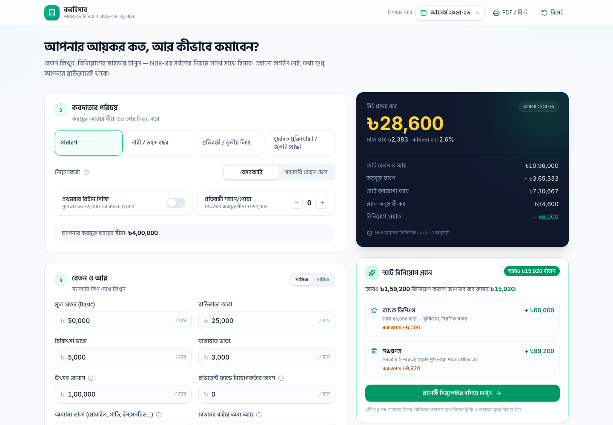
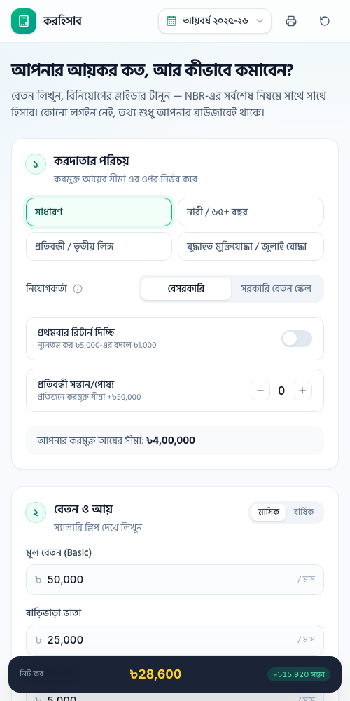

<div align="center">


# করহিসাব: Income Tax & Investment Rebate Simulator

**A Bangladesh income-tax calculator for salaried people, using the latest NBR rules. It also shows how much tax each extra taka of investment (DPS, sanchaypatra, shares) would save.**

বেতন লিখুন, স্লাইডার টানুন, সাথে সাথে দেখুন কত কর দিতে হবে আর কীভাবে কমানো যায়।




</div>

---

## Case summary

### The problem

Every tax season, salaried people in Bangladesh ask the same two questions:

1. *How much income tax will I pay?*
2. *How much should I invest, and where, to pay less?*

The online calculators that answer them have two problems:
- **Many use outdated rules.** Finance Act 2026 raised the tax-free threshold from 3.5 lakh to 4 lakh, removed the 5% slab, and cut the investment rebate from 15% to 10% with a ৳7.5 lakh cap. Most blogs and calculators still show the old figures. Even this project's own starting blueprint did.
- **None treat the rebate as a plan.** People are told "invest more", but not how much more or where. Nothing shows the point where an extra taka stops saving tax.

### The approach

| Decision | Why |
|---|---|
| **Every rule comes from an official NBR document**, with a page number beside each figure in the code | The calculator is for a public launch, and a wrong number can make someone invest wrongly or file a wrong return |
| **Rules are kept apart from code**, one file per tax year | A new budget means adding one data file, with no engine changes |
| **NBR's own worked examples are the tests** | If a rule is entered wrong, the test fails against NBR's own published answer |
| **No backend, no login** | Salary data is sensitive. Everything is calculated in the browser and saved only to `localStorage` |
| **The advisor re-runs the real calculator** for each suggestion | So "you'll save ৳X" includes every limit: the 3% income cap, the ৳7.5 lakh cap, per-head limits and minimum tax |
| **Bangla first** (Hind Siliguri for text, Inter for numbers) | The audience reads Bangla. Numbers use lakh grouping (10,96,000), as on a salary slip |

### What changed from the blueprint

The original A-to-Z blueprint was a useful starting point, but checking it against the official sources showed these problems:

| Area | Blueprint | Now (verified) |
|---|---|---|
| Tax-free threshold | ৳3,50,000 | **৳4,00,000** (women/65+ ৳4.5L, disabled ৳5.25L, freedom fighter/July Joddha ৳5.5L) |
| Slabs | 5 / 10 / 15 / 20 / 25% | **10 / 15 / 20 / 25 / 30%**; the 5% slab is gone |
| Rebate | least of 3%, **15%**, ৳10 lakh | least of 3%, **10%**, **৳7.5 lakh**, and never more than the tax |
| Salary exemption | 1/3 or ৳4.5 lakh | 1/3 or **৳5 lakh**; govt pay-scale employees follow a different rule |
| Minimum tax | ৳5,000 (Dhaka/Ctg) / ৳4,000 | **৳5,000 nationwide**, ৳1,000 for first-time filers |
| Advisor's "tax saved" | 15% of each suggested amount | **The actual reduction**, from re-running the calculator |
| PDF export | `@react-pdf/renderer` | **Browser print**, because client-side PDF libraries break Bangla conjuncts |
| Hydration | Persisted store read during SSR | **Rehydrated after mount**, so there is no mismatch |

### The result

- **74 automated tests.** 13 worked examples from *Income Tax Nirdeshika 2026-27* and 4 from *Paripatra 2026-27* reproduce NBR's published answers to the taka. The rest cover the advisor, filing windows, storage and UI behaviour.
- **Two income years are available:** the return being filed now (2025-26) and the current planning year (2026-27, confirmed from Finance Act 2026, Schedule 2).
- **Interactions are smooth and accessible.** Numbers count up, the layout doesn't jump, reset has an undo, the controls work with the keyboard, and motion follows `prefers-reduced-motion`.

---

## Features

- **Live tax calculation.** Results update as you type, with monthly or annual entry and every taxpayer category.
- **Investment simulator.** Sliders for DPS, sanchaypatra, and shares/mutual funds, plus PF, life insurance, the universal pension and donations. A meter shows how much of the rebate limit you've used.
- **Smart plan.** It shows how much more to invest and in what order (DPS → sanchaypatra → shares), with the actual tax saved at each step. One click applies the plan to the simulator.
- **Filing timeline.** The 5% early-filing incentive and the extra tax for late filing, with today's window highlighted.
- **Slab breakdown.** Shows how much tax falls in each band.
- **Print / PDF.** A clean A4 summary through the browser's "Save as PDF".
- **Privacy.** No account and no server. Inputs stay in your browser.

<div align="center">

<br/><sub>On mobile, the net tax stays pinned at the bottom of the screen.</sub>
</div>

---

## Tax rules at a glance (tax year 2026-27)

| Step | Rule | Source |
|---|---|---|
| Salary exemption | lower of 1/3 of gross salary or ৳5,00,000 (private sector) | Nirdeshika p.31 |
| Tax-free threshold | ৳4L general · ৳4.5L women/65+ · ৳5.25L disabled/third gender · ৳5.5L freedom fighter/July Joddha · +৳50k per disabled child | Nirdeshika p.19 |
| Slabs | next 3L @10% · 4L @15% · 5L @20% · 20L @25% · rest @30% | Nirdeshika p.19 |
| Investment rebate | least of 3% of income, 10% of eligible investment, ৳7.5 lakh | Nirdeshika p.67 |
| Per-head limits | DPS ৳1.2L/yr · govt securities ৳5L · PF counts both employee and employer shares | Nirdeshika p.67, p.107 |
| Minimum tax | ৳5,000 nationwide (৳1,000 for a new taxpayer) | Nirdeshika p.66 |
| Filing incentive | Jul–Sep −5% (max ৳25k) · Jan–Mar +2% or ৳3k · Apr–Jun +5% or ৳5k | Nirdeshika p.12 |

Full details with page references: [`docs/ARCHITECTURE.md`](docs/ARCHITECTURE.md).

> **Not covered yet:** final-tax income (such as sanchaypatra profit), capital gains, business income, the wealth surcharge, and non-resident taxpayers.

---

## Getting started

```bash
npm install
npm run dev        # http://localhost:3000
```

| Script | What it does |
|---|---|
| `npm run dev` | Start the development server |
| `npm test` | Run all tests (Vitest) |
| `npm run lint` | Run ESLint |
| `npm run build` | Cloudflare (OpenNext) production build |
| `npm run build:next` | Plain Next.js build |
| `npm run preview` | Run the Cloudflare build locally |

Requires Node.js 20.9 or later.

---

## Project structure

```
src/
├── lib/tax/              # pure TypeScript engine: no React, fully unit-tested
│   ├── rules/            # one file per tax year, with NBR page references
│   ├── calculator.ts     # income → exemption → slabs → rebate → minimum tax
│   ├── advisor.ts        # where to invest next, and the real tax saved
│   └── filing.ts         # filing-date incentive or extra tax
├── store/                # Zustand + debounced localStorage persistence
├── hooks/                # useTaxModel, useAnimatedNumber, useToday
├── components/           # dashboard cards + ui/ (Select, Toast, Collapse, …)
└── app/                  # layout, page, icons, global styles
```

### Adding a new budget year

1. Copy `src/lib/tax/rules/ty2027-28.ts` to a new file and update the figures, writing the source page number beside each one.
2. Register it in `src/lib/tax/rules/index.ts`. It then appears in the year picker automatically.
3. Add the new Nirdeshika's worked examples as tests.
4. Ship only when `npm test` is green.

Coming next: from tax year 2028-29 the threshold rises to ৳4.5 lakh and a 35% band applies above ৳3 crore (Finance Act 2026, p.143).

---

## Sources

- [আয়কর নির্দেশিকা ২০২৬-২০২৭, NBR](https://nbr.gov.bd/uploads/publications/Aykor_Nirdashikha_2026-2027_BG_Press_Modify_Copy.pdf)
- [আয়কর পরিপত্র ২০২৬-২০২৭, NBR](https://nbr.gov.bd/uploads/paripatra/Aykor_Poripothro_2026-2027_BG_Press_Modify_Copy.pdf)
- [Finance Act, 2026](https://nbr.gov.bd/uploads/acts/Finance_Act_2026.pdf)
- File returns online: [etaxnbr.gov.bd](https://etaxnbr.gov.bd)

## Disclaimer

This tool gives estimates based on published NBR guidance. It is not legal, tax or investment advice. Check your return with a tax professional when in doubt.
